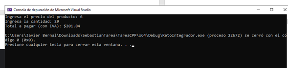

# Introducción a la Programación Básica en C++: Calculadora de IVA y Envío

## Creador
* Francisco Javier Bernal Calvo

## Descripción
Este repositorio contiene un programa básico de consola desarrollado en C++ como parte de una serie de ejercicios introductorios para aprender los fundamentos del lenguaje (sintaxis básica, entrada/salida de datos, variables y estructuras condicionales). 

El programa solicita al usuario el precio unitario de un producto y la cantidad comprada, calcula el total a pagar incluyendo el 16% de IVA y determina si la compra supera los $1,000 para aplicar a envío gratuito.

## Información del Proyecto, Configuraciones e Instrucciones
* **Lenguaje:** C++
* **Entorno de desarrollo:** Microsoft Visual Studio (compatible con GCC, MinGW, Dev-C++ o VS Code)

### Instrucciones de Compilación y Ejecución
1. Clonar el repositorio o descargar el archivo `.cpp`.
2. Abrir el archivo en Microsoft Visual Studio o en cualquier compilador de C++.
3. Compilar y ejecutar el programa.
4. Ingresar el precio y la cantidad solicitados por la consola para obtener el desglose del total.

## Imágenes

imagen_2026-10-08_202318851
